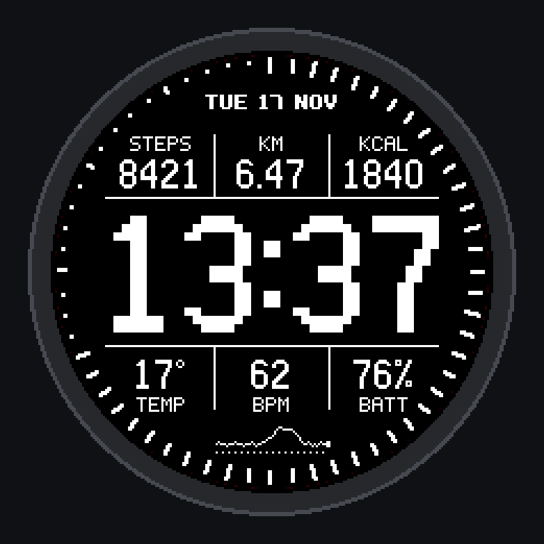
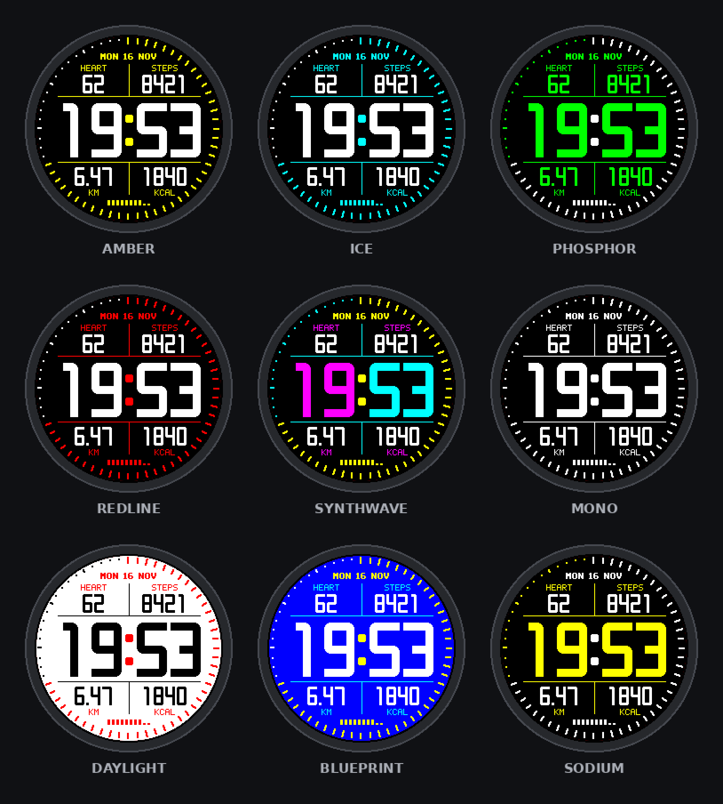
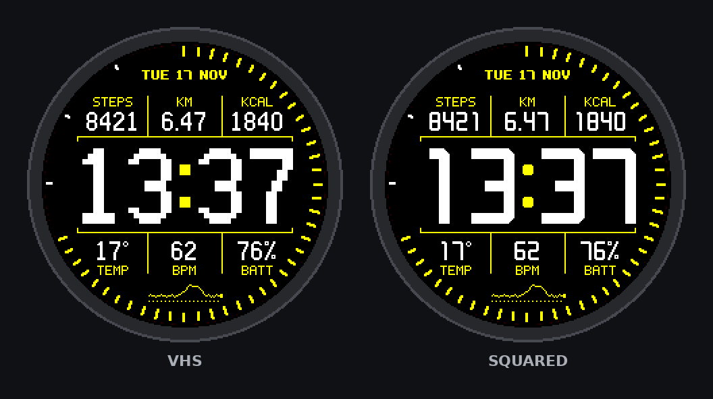

# Apogee

A retro-futuristic digital watch face for the **Garmin Forerunner 55**.



A big video-recorder clock, six data fields, two gauges, and nothing else.
Every part of it can be recoloured, either from a list of themes or one piece
at a time.



The numerals come in two styles you can switch between on the watch: **VHS**
(chunky, stair-stepped, like a tape deck's on-screen clock) and **Squared**
(smooth, rounded-corner, space-age).



## What's on the face

```
           . ' | ' .            outer ring   60 ticks; the lit ones show progress to your step goal
          MON 16 NOV            date
      STEPS |  KM  | KCAL
       8421 | 6.47 | 1840       three data fields
     ----------------------
            13:37               time (follows the watch's 12/24 h setting)
     ----------------------
        17° |  62  | 76%        three more data fields
       TEMP | BPM  | BATT
         _/\__/\_.             bottom bar   your heart rate over the last 4½ hours
```

- **Data fields** – each of the six can show any of these, or be left empty:

  | Field            | Shows                                                   |
  | ---------------- | ------------------------------------------------------- |
  | Steps            | today's step count                                      |
  | Heart rate       | current beats per minute                                |
  | Battery          | charge, in percent                                      |
  | Distance         | today's distance, in km or miles                        |
  | Calories         | today's calories                                        |
  | Intensity min    | this week's intensity minutes                           |
  | Temperature      | current temperature where you are                       |
  | Rain chance      | chance of rain, in percent                              |
  | Wind speed       | current wind, in km/h or mph                            |
  | Sunrise/set      | the next sunrise or sunset                              |
  | Recovery hrs     | hours left on Garmin's recovery advisor                 |
  | VO2 max          | your running VO2 max estimate                           |
  | Resting HR       | your resting heart rate                                 |
  | Notifications    | unread notification count                               |

  Temperature, rain, wind and sunrise/sunset come from the weather report the
  watch receives from your phone, for wherever the phone is. They show `--`
  until the watch has synced with Garmin Connect.
- **Bottom bar** – by default a small trace of your heart rate over the last
  4½ hours, like a bedside monitor, with a dot on the latest reading. Each
  pixel is five minutes, and it moves on every five minutes. It can
  instead show **status icons** (phone connected or lost, alarm set,
  do-not-disturb, unread messages – each only while it applies), or a gauge.
- **Scanlines** (off by default) – thin dark lines run through the time
  like an old CRT screen; the colon is left solid. Switch them on under
  *Customize → Scanlines*.
- **Blinking colon** – for the few seconds after you raise your wrist, the
  colon blinks once a second like a tape deck's clock.
- **Outer ring** – twelve hour marks, plus a lit tick for every 1/60th of
  progress. Shows step goal by default; can also show battery, weekly
  intensity-minute goal, or nothing.
- **Seconds tick** – for the few seconds after you raise your wrist, a bright
  tick runs round the ring. (The watch only redraws once a minute the rest of
  the time, which is what keeps the battery life.)
- **Side icons** – when the bottom bar shows a trace or gauge, a small icon
  appears left of it if the phone connection drops, and right of it when you
  have unread notifications.
- **Low battery** – at 15% or below, a red battery icon appears beside the
  bottom bar (in place of the notifications icon), and a Battery field, if
  you show one, turns red. In *status icons* mode the battery leads the row.

## Install it

You need the file [`dist/Apogee.prg`](dist/Apogee.prg) and the watch's USB
cable. No account, no publishing.

1. Plug the Forerunner 55 into a computer. It shows up as a drive called
   **GARMIN**. (On a Mac, if it doesn't appear in Finder, install
   [OpenMTP](https://openmtp.ganeshrvel.com/) and use that to browse it.)
2. Copy `Apogee.prg` into the **`GARMIN/APPS`** folder.
3. Eject the drive and unplug the watch.
4. On the watch: hold **UP** → **Watch Face** → scroll to **Apogee** →
   press **START** → **Apply**.

To update later, copy a newer `Apogee.prg` over the old one.

## Change the colours and fields

### On the watch

Hold **UP** → **Watch Face** → highlight **Apogee** → **START** →
**Customize**. You get this menu:

| Menu           | What it does                                                          |
| -------------- | --------------------------------------------------------------------- |
| **Theme**      | Pick one of the ten built-in colour schemes, or *Custom*.             |
| **Numerals**   | Switch the numeral style between *VHS* and *Squared*.                 |
| **Colours**    | Set the colour of one part: background, hours, minutes, date, data values, data labels, lines, ring ticks, accent. |
| **Data fields**| Choose what each of the six fields shows.                             |
| **Outer ring** | Choose what the ring measures.                                        |
| **Bottom bar** | Heart trace, status icons, or a gauge (step goal, battery, intensity goal). |
| **Seconds tick** | Turn the wrist-raise seconds tick on or off.                        |
| **Scanlines**  | Turn the CRT scanlines through the time on or off.                    |

Changing a single colour while a theme is active copies that theme into
*Custom* first, so you adjust what you're looking at instead of starting from
scratch.

The Forerunner 55's screen can show exactly eight colours – black, white, red,
yellow, green, cyan, blue, magenta – so those are the choices everywhere.

### On your phone (optional)

Garmin only offers a phone settings screen for faces installed through the
Connect IQ Store, not for ones copied over USB. If you'd like that, you can
upload Apogee as a **private beta** that only your own Garmin account can see:

1. Go to <https://apps.garmin.com/developer> and sign in with the Garmin
   account your watch uses. Accept the developer agreement.
2. Choose **Upload an App** and select [`dist/Apogee.iq`](dist/Apogee.iq).
3. Fill in a title and description, use `docs/preview.png` where it asks for
   images, and tick **Beta App**. Beta apps skip review and stay private.
4. Delete `Apogee.prg` from `GARMIN/APPS` if you side-loaded it earlier (two
   copies of the same face confuse the watch).
5. On your phone, open the **Connect IQ** app, find Apogee under your account
   and install it, then let the watch sync.
6. Settings are then under **Connect IQ app → My Device → My Watch Faces →
   Apogee → Settings**.

Keep the developer key that signed `Apogee.iq` somewhere safe: Garmin only
accepts updates to a store listing if they are signed with the same key.

## Make it your own

Everything is plain text and commented. The usual places to tinker:

| I want to…                                   | Edit                                                    |
| -------------------------------------------- | ------------------------------------------------------- |
| change a built-in theme, or add one          | `THEMES` in [`source/Config.mc`](source/Config.mc)      |
| change the default theme, fields or gauges   | `<properties>` in [`resources/settings/settings.xml`](resources/settings/settings.xml) |
| move things around on screen                 | the constants at the top of [`source/ApogeeView.mc`](source/ApogeeView.mc) |
| add a new kind of data field                 | [`source/Data.mc`](source/Data.mc) (plus its name in `strings.xml`, `settings.xml`, `Settings.mc`) |
| redraw a VHS numeral                         | the `VHS` table in [`tools/make_fonts.py`](tools/make_fonts.py), then re-run it |
| change the weight or roundness of the Squared numerals | `TIME_SQUARE` / `DATA_SQUARE` in `tools/make_fonts.py`, then re-run it |
| redraw a letter or icon                      | the `LABEL` table in `tools/make_fonts.py`, then re-run it |

The fonts are original to this project. Because the screen has no
anti-aliasing, ordinary fonts turn ragged at these sizes, so
`tools/make_fonts.py` draws every glyph directly on the pixel grid and writes
the bitmap font files in `resources/fonts`. It needs Python 3 and Pillow:

```bash
pip install pillow
```

```bash
python3 tools/make_fonts.py
```

## Build it yourself

1. Install [Visual Studio Code](https://code.visualstudio.com/) and, from its
   Extensions panel, **Monkey C** (by Garmin).
2. Download the [Connect IQ SDK Manager](https://developer.garmin.com/connect-iq/sdk/),
   sign in, and use it to download the latest SDK and the **Forerunner 55**
   device.
3. Open this folder in VS Code. Press `Ctrl/Cmd+Shift+P` and run
   **Monkey C: Generate a Developer Key** (once).
4. Press **F5** to run the face in Garmin's simulator.
   *Settings → Trigger App Settings* in the simulator opens the on-watch menu.
5. To make a file for the watch, run **Monkey C: Build for Device**, choose
   **fr55**, and copy the resulting `.prg` to `GARMIN/APPS`.
   For a store upload, run **Monkey C: Export Project** to get an `.iq`.

Prefer a terminal? `tools/build.sh` does the same two builds.

## Project map

```
manifest.xml                  app id, type (watch face), supported device
monkey.jungle                 build configuration
source/
  ApogeeApp.mc                entry point
  ApogeeView.mc               draws the face; layout constants live here
  Config.mc                   palette, themes, reading/writing settings
  Data.mc                     reads steps, heart rate, battery, weather…
  Settings.mc                 the on-watch settings menu
resources/
  settings/settings.xml       stored settings, their defaults, phone settings screen
  strings/strings.xml         every piece of user-visible text
  fonts/                      generated bitmap fonts
  drawables/                  launcher icon
tools/
  make_fonts.py               generates resources/fonts
  make_icon.py                generates the launcher icon
  build.sh                    command-line build
dist/
  Apogee.prg                  ready to copy to the watch
  Apogee.iq                   ready to upload to the Connect IQ Store
```
